# 🏹 BowTally

> Turnierverwaltung für 3D-Bogenturniere – von der Ausschreibung bis zur druckfertigen Ergebnisliste.

[](https://www.microsoft.com/windows)
[](https://www.python.org/)
[](LICENSE)
[](CHANGELOG.md)

---

## 🤔 Wofür?

Bogenvereine organisieren 3D-Turniere bislang mit einer Mischung aus Tabellenkalkulation, Word-Vorlagen und handgeschriebenen Listen. BowTally ersetzt das komplett: ein einziges Programm führt durch alle acht Phasen eines Turniers – von der Ausschreibung bis zur Siegerehrung.

Die Anwendung läuft vollständig offline. Alle Daten bleiben lokal auf dem Gerät. Es werden keine personenbezogenen Daten oder Turnierdaten an externe Server übertragen. Das optionale Nextcloud-Backup lädt ausschließlich auf expliziten Nutzerwunsch ein passwortgeschütztes Backup auf einen selbst betriebenen Server hoch. Nextcloud dient dabei nur als Speicherziel für Backups: Es gibt keinen Abgleich zwischen Geräten und kein Herunterladen durch BowTally. Weitere Hinweise unter [docs/PRIVACY.md](docs/PRIVACY.md).

---

## 🔄 Turnierphasen

```mermaid
flowchart LR
    A([🖊️ <br> Entwurf]) --> B([📄 <br> Ausschreibung])
    B --> C([🔧 <br> Vorbereitung])
    C --> D([✅ <br> Anmeldung])
    D --> E([🏁 <br> Einschreibung])
    E --> F([🎯 <br> Schießen])
    F --> G([🏆 <br> Auswertung])
    G --> H([✔️ <br> Abgeschlossen])

    style A fill:#6c757d,color:#fff,stroke:none
    style B fill:#0d6efd,color:#fff,stroke:none
    style C fill:#0dcaf0,color:#000,stroke:none
    style D fill:#198754,color:#fff,stroke:none
    style E fill:#20c997,color:#fff,stroke:none
    style F fill:#ffc107,color:#000,stroke:none
    style G fill:#fd7e14,color:#fff,stroke:none
    style H fill:#343a40,color:#fff,stroke:none
```



---

## ✨ Funktionen

### Turnierablauf

- 🔄 **Acht Phasen** – geführter Ablauf: Entwurf → Ausschreibung → Vorbereitung → Anmeldung → Einschreibung → Schießen → Auswertung → Abgeschlossen. Vor jedem Wechsel prüft BowTally Voraussetzungen: Blocker sperren den Wechsel, Warnungen können bewusst übergangen werden. Jeder Wechsel wird protokolliert.
- 📋 **Leitfaden** – Erklärung, Aufgaben mit Direktlinks, Statusampeln und abhakbare Checkliste je Phase.
- 🧙 **Turnier-Assistent** – acht Schritte: Grunddaten (mit internen Notizen), Konfiguration (Wertungsmodus, maximale Teilnehmerzahl mit Auslastung, Startgruppen, Regelwerk und Runden), Bogenklassen (Standard-Klassen zuerst, dann eigene, alphabetisch; Option „Nur eigene Klassen anzeigen“), Fristen und Zeiten, Startgebühren, Kontakt und Bankdaten, Hinweise und Texte, Zusammenfassung.
- 📋 **Turnier kopieren** – bestehendes Turnier als Vorlage nutzen; Parcours-Ziele und Preise werden übernommen, Teilnehmer und Ergebnisse nicht.
- 📝 **Notizen** – freies Textfeld je Turnier (interne Notizen aus dem Assistenten landen hier); erscheint nie in der Ausschreibung, wird auf dem Dashboard und im abgeschlossenen Leitfaden angezeigt und im Turnier-Export mitgeliefert.
- 📅 **Jahreskalender** – Monatsraster mit allen Turnieren als farbige Badges nach Phase, ICS-Export; Doppelklick auf einen Tag legt dort ein neues Turnier an.

### Ausschreibung und Anmeldung

- 📄 **Ausschreibungs-PDF** – Termin, Ablauf, Klassen, Startgeld, Bankverbindung und Kontakt aus den Turnierdaten; BowTally zeigt an, wenn die Ausschreibung nach Änderungen veraltet ist. Nach dem Erzeugen öffnet sich ein E-Mail-Entwurf mit dem PDF im Anhang. Allgemeine Turnierregeln und Teilnahmebedingungen (global unter Regelwerke → Turnierregeln gepflegt) werden als Zusatzseite angehängt.
- 💶 **Startgebühren** – je Turnier, vorbelegt aus Vorlagen; Einnahmenübersicht mit erwarteten, eingegangenen und ausstehenden Beträgen.
- ✉️ **E-Mail-Vorlagen** – Ausschreibung, Anmeldebestätigung, Zahlungserinnerung, Startunterlagen, Helfer-Bestätigung, Datenauskunft, Ergebnisversand; Platzhalter und Vereinslogo in der Signatur, Schriftart aus den Einstellungen. Schützen können einzeln für den Ergebnisversand per E-Mail vorgemerkt werden.
- 💬 **WhatsApp** – Anmeldebestätigung, Zahlungserinnerung, Startunterlagen, Warteliste, Helfer-Bestätigung und Datenauskunft auch als WhatsApp-Chat mit vorausgefülltem Text (Click-to-Chat `wa.me`, eigene Vorlagen); Nummern werden lokal ins internationale Format gebracht, mehrere Empfänger nacheinander in einem Dialog. Ohne Anhänge, daher Ergebnisversand und Ankündigung nur per E-Mail.
- ✅ **Anmelde- und Zahlungsstatus** – je Teilnehmer; Schnellaktionen per Rechtsklick und Aktionsleiste. **Neuer Schütze** legt einen Schützen direkt aus dem Turnier in den Stammdaten an und weist ihn gleich zu.
- 🔢 **Maximale Teilnehmerzahl** – Auslastungsbalken; bei voller Belegung sind Zuweisen und Import gesperrt, Walk-ins bleiben möglich.

### Turniertag

- 🏁 **Einschreibe-Ansicht** – Suche nach Name oder Startnummer (mit den Buttons rechts in der Zeile von Zähler und Auslastungsbalken), Einchecken per Enter, Walk-in-Erfassung, Einschreibeliste drucken.
- ⌨️ **Ergebniseingabe per Tastatur** – Enter/↓/↑ wechselt Teilnehmer, Tab die Scheibe; Name und Summe bleiben beim Scrollen sichtbar; jede Eingabe wird sofort gespeichert. Runden- und Gesamteingabe nehmen nur Zahlen an.
- 🎯 **Auslosung** – (nur wenn im Turnier-Assistenten „Teilnehmer per Auslosung einteilen“ gewählt wurde) automatische Gruppeneinteilung mit Startnummer und Startscheibe, optional getrennt nach Bogenklasse; direkt danach Wertungszettel drucken.
- 🗓️ **Zeitplan** – Startgruppen mit Startzeit und Dauer, PDF-Druck Zeitplan-Aushang. Die Startgruppen berechnet der Turnier-Assistent aus maximaler Teilnehmerzahl und der Einstellung „Teilnehmer pro Gruppe“.
- 📐 **Parcours-Planung** – alle Scheiben/Ziele mit Distanz, Pfeilstopp, Geländetyp, Reihenfolge per Drag-and-Drop, Material aus dem Inventar mit angeforderter Menge und Einmalposten; PDF-Druck Aufbauplan und Zielplan.
- 📋 **Wertungszettel-Vorlagen** – konfigurierbare Spalten per Drag-and-Drop-Editor; vier eingebaute Vorlagen: 3D-Standard, Feld-Standard, Halle 10-Ring, Blasrohr-Standard.

### Auswertung

- 🏆 **Ranglisten** – je Bogenklasse und gesamt, Podium hervorgehoben, „ex aequo" bei Gleichstand; Gleichstandsregeln je Regelwerk (Kills, X-Treffer, Treffer in der höchsten Wertung), Hinweis und Ergebniseingabe für ein nötiges Stechen (Spalte „Stechen“ in Liste, Export und PDF).
- 📄 **Ergebnisliste** – druckfertiges PDF mit Deckblatt und Vereinslogo, eine Seite je Klasse; mit dem Erstellen werden Ergebniseingabe und Helfer gesperrt. Versand per E-Mail mit PDF im Anhang an die vorgemerkten Schützen.
- 🥇 **Preis- und Siegerliste** – Rangliste mit zugewiesenen Preisen je Klasse als PDF.
- 🏷️ **Watermark** – jeder PDF-Ausdruck trägt unten rechts das BowTally-Logo, „sponsored by BowTally“ und einen kleinen QR-Code zum Repository.
- 📜 **Urkunden** – genau eine A4-Seite je Podiumsplatz und Klasse mit Rahmen, Vereinslogo, Siegel in Gold/Silber/Bronze, Name, Klasse, Punkten, Turniername sowie Unterschriftszeilen für 1. und 2. Vorsitzende/n (Ort/Datum darüber) als PDF; Podiumsplätze bekommen ihre Urkunde auf Wunsch mit der Ergebnis-Mail.
- 📤 **Export** – CSV, Excel oder OpenDocument, auch alle Turnierdaten auf einmal.
- 🔁 **Multi-Runden-Turniere** – beliebig viele Runden, jede mit eigenem Regelwerk; Wertung „Zielwertung“, „Rundenwertung“ oder „Gesamtwertung“ (bei den beiden letzten mit Spalte für Kills/X neben den Punkten).

### Stammdaten

- 🏹 **Schützen** – Passnummer, Suche, aktiv/inaktiv; Notizen und Dokumente in eigenen Tabs; Import CSV/XLSX/ODS mit Spalten-Zuordnung, Vorschau, Validierung und Duplikatbehandlung; jeder Schütze nur einmal je Turnier (Prüfung über Datensatz und Name).
- 📏 **Regelwerke** – 9 eingebaute Regelwerke mit Gleichstandsregeln nach WA, IBO, IFAA und DBSV (3D Hunter, IBO 3D Standard/12-Ring, WA 3D, DBSV Waldrunde, IFAA Feld bekannt/unbekannt, WA Halle 18 m/25 m) plus eigene durch Klonen; Kills/X, Disziplin, Gleichstand und Stechen je Regelwerk einstellbar, Regelwerke lesbar exportier-/importierbar.
- 👥 **Mitglieder** – Mitgliederkartei mit Mitgliedsnummer, Adresse, Einwilligung (Datum erscheint beim Ankreuzen), Notizen und Dokumente in eigenen Tabs, Bankverbindung (IBAN-Prüfziffer, SEPA-Mandat) und Helferhistorie (manuelle Einsätze lassen sich mit einem bestehenden Turnier verknüpfen); Datenauskunft per E-Mail mit maskierter IBAN; Excel-Export/-Import ohne Bankdaten.
- 🙋 **Turnier-Helfer** – je Turnier manuell oder „Aus Mitgliederkartei“ (nur Mitglieder mit Kennzeichen Turnierhelfer); Aufgabe, Zeiten und Bestätigung, Helferliste als PDF, E-Mail-Bestätigung; gesperrt, sobald die Ergebnisliste erstellt ist; beim Abschluss des Turniers entsteht ein Eintrag in der Helferhistorie.
- 📦 **Inventar und Logbuch** – Ausrüstung (Ziele, Tische, Pavillons …) mit Kategorien, Preisen, Dokumenten und Reparaturkosten (mit verlinkter Rechnung) verwalten, Artikel aktiv/inaktiv, Parcoursplan mit Bestandsprüfung; Logbuch als Tabelle aller Aktivitäten, eine Zeile je Eintrag (filterbar).
- 🎯 **Bogenklassen** – zehn Standardklassen, eigene Klassen, Reihenfolge per Drag-and-Drop.
- ⌨️ **Vorformatierte Eingabefelder** – Datum `__.__.____` (mit Kalender), Uhrzeit `__:__` und Beträge `__,__ €` (wächst bei größeren Beträgen bis `____,__ €`) werden direkt im Feld getippt.

### Einstellungen

- 🏢 **Vereinsprofil** – Name, Adresse, Logo, Bankdaten (IBAN, BIC, Verwendungszweck-Vorlage mit Platzhaltern).
- 👥 **Vereinsvorstand** – Vorname, Nachname, Telefon und E-Mail je Vorstandsrolle; im Turnier-Assistenten per Klick als Turnierkontakt übernehmen.
- 🎨 **Design** – Hell/Dunkel/System-Theme, Primärfarbe und alle App-Farben individuell anpassbar, eigene Druckfarben für alle PDF-Ausdrucke, Schriftart wählbar (Open Sans, Inter und Source Sans 3 werden mitgeliefert, dazu Segoe UI; gilt auch für PDFs). Lizenzen der Schriften: `docs/THIRD-PARTY-NOTICES.md`.
- 💾 **Backup** – passwortgeschütztes ZIP-Backup (AES-256, Pflicht-Passwort) mit allen Daten (JSON, inklusive Einstellungen mit Logging-Modus, E-Mail- und WhatsApp-Vorlagen, Logbuch, Mitglieder-Bankdaten, Inventar und der Dokumente von Mitgliedern, Schützen und Inventar), Vereinslogo und Prüfdatei `bowtally.info`, Nextcloud-Upload (WebDAV), automatisches Backup beim Beenden, Aufbewahrung der letzten N Backups (Anzahl einstellbar, lokal, Netzwerk und Nextcloud), Wiederherstellung inklusive Umstellung alter Backups; vor Datenbank-Migrationen entsteht automatisch eine Kopie der Datenbank.
- 🔄 **Updates** – optionale Prüfung auf neue Versionen über GitHub-Releases (abschaltbar), Download mit Prüfsumme und stiller Installation; Netzwerkfehler werden angezeigt.
- 🪵 **Erweitert** – Logging-Modus der Logdatei `app.log` (Info, Warnung, Debug; Standard Info, Debug nur nach Warnhinweis), Button „Logfile öffnen“.
- ❓ **Hilfe und Über BowTally** – ausführliche App-Hilfe mit Suche (F1), Lizenztext und Changelog im Programm.

---

## 📋 Anforderungen

| Komponente | Version |
|---|---|
| Windows | 10 oder 11 (64 Bit) |
| Python | 3.11 oder neuer (nur für Entwicklung) |
| NSIS | 3.x (nur für Build) |

Für Endanwender ist **keine Python-Installation nötig** – der Installer bringt alles mit.

---

## 🏗️ Projektstruktur

```
bowtally/
│
├── bowtally/
│   ├── __version__.py          – Versionsnummer (einzige Quelle der Wahrheit)
│   ├── database/               – ORM-Modelle, Engine, Alembic-Migrationen, Seed-Daten
│   ├── services/               – Geschäftslogik (kein UI-Code): Turniere, Teilnehmer,
│   │                             Wertung, Rangliste, Parcours, Auslosung, Preise, Einstellungen
│   ├── reports/                – PDF-Erzeugung: Ergebnisliste, Ausschreibung, Einschreibeliste,
│   │                             Parcours, Zeitplan, Wertungszettel, Urkunden, Preis-/Siegerliste
│   ├── io/                     – Import/Export CSV, XLSX, ODS
│   └── ui/
│       ├── components/         – Wiederverwendbare Widgets (Seitenpanel, Tabelle, Chips, …)
│       ├── views/              – Seiten (Dashboard, Leitfaden, Turniere, Schützen, …)
│       ├── dialogs/            – Turnier-Assistent, Auslosung, Einstellungen, Import/Export
│       └── theme.py            – Stylesheet, Farbpalette und Icons aus den Einstellungen
│
├── build/
│   ├── bowtally.spec           – PyInstaller-Spec
│   ├── build.bat               – Baut Anwendung (PyInstaller) und Installer (NSIS) in einem Schritt
│   ├── setup-dev.bat           – Einmaliges Dev-Setup: venv anlegen und Abhängigkeiten installieren
│   └── setup.nsi               – NSIS-Installer-Skript
│
├── docs/
│   ├── BowTally_Ersteinrichtung.md – Benutzeranleitung: Installation und Ersteinrichtung
│   ├── BowTally_Phasensystem.md    – Benutzeranleitung: Turnierphasen Schritt für Schritt
│   ├── PRIVACY.md                  – Datenschutzhinweise
│   ├── SECURITY.md                 – Sicherheitshinweise und Disclosure Policy
│   └── THIRD-PARTY-NOTICES.md      – Drittanbieter-Lizenzen
│
├── tests/                      – pytest
├── CHANGELOG.md
├── LICENSE
└── README.md
```

---

## ⚡ Schnellstart

### 1. Installieren

Installer `BowTally-<version>-Setup.exe` von der [Releases-Seite](https://github.com/jenskaesler/bowtally/releases) herunterladen und ausführen.

### 2. Einrichten

Beim ersten Start erscheint der Erststart-Assistent. Anschließend unter **Einstellungen → Vereinsprofil** Vereinsname, Kontakt und Logo eintragen.

### 3. Erstes Turnier anlegen

**Turniere → Neues Turnier** – den Assistenten durchgehen; anschließend im Leitfaden das Ausschreibungs-PDF generieren.

### 4. Phasen durchlaufen

Im **Leitfaden** die Aufgaben je Phase abarbeiten und über **Nächste Phase** in der Seitenleiste weiterschalten.

### 5. Turniertag

In der **Einschreibung** einchecken, im **Schießen** Ergebnisse eintragen.

### 6. Auswertung

Ergebnisliste, Urkunden und Preis- und Siegerliste erstellen, Turnier abschließen.

---

## 📚 Dokumentation

| Dokument | Inhalt |
|---|---|
| [Ersteinrichtung](docs/BowTally_Ersteinrichtung.md) | Installation, Stammdaten, erstes Turnier anlegen |
| [Phasensystem](docs/BowTally_Phasensystem.md) | Turnierverwaltung Schritt für Schritt – alle acht Phasen erklärt |
| [Datenschutz](docs/PRIVACY.md) | Datenverarbeitung, Speicherorte, optionales Nextcloud-Backup |
| [Sicherheitshinweise](docs/SECURITY.md) | Schwachstellen melden, Kontakt, Disclosure Policy |
| [Drittanbieter-Lizenzen](docs/THIRD-PARTY-NOTICES.md) | Verwendete Open-Source-Bibliotheken und ihre Lizenzen |

---

## 🔧 Entwicklung

```bat
git clone https://github.com/jenskaesler/bowtally.git
cd bowtally
build\setup-dev.bat
```

`setup-dev.bat` legt `.venv` an und installiert alle Abhängigkeiten inkl. Dev-Tools (`pytest`, `pyinstaller`).

```bat
.venv\Scripts\activate
python -m bowtally.main
pytest
```

Mit der Umgebungsvariable `BOWTALLY_DATA_DIR` lässt sich das Datenverzeichnis umlenken (Tests, portable Installation).

### Datenbank-Migrationen

Schema-Verwaltung mit Alembic (`bowtally/database/migrations`). Beim Start wird die Datenbank automatisch migriert. Neue Migration anlegen:

```bat
cd bowtally\database
alembic -c alembic.ini revision -m "beschreibung"
```

### Datenspeicherorte

| Datei | Ort |
|---|---|
| Datenbank | `%APPDATA%\BowTally\bowtally.db` |
| Log | `%APPDATA%\BowTally\app.log` |
| Erzeugte PDFs und Exporte | Export-Ordner (Standard: Downloads, in den Einstellungen änderbar) |

Datenbank und Log bleiben bei Updates und Deinstallation erhalten. Zur Datensicherung das Backup in den Einstellungen nutzen (enthält auch das Vereinslogo); alternativ genügt eine Kopie von `bowtally.db`.

---

## 🏭 Build

Voraussetzungen: Dev-venv (siehe oben) und [NSIS 3](https://nsis.sourceforge.io/).

```bat
build\build.bat
```

Als ersten Schritt ruft das Skript `bump-version.ps1` auf: neue Version wählen (Patch, neuer Monat, frei) oder mit `Q` ohne Versionswechsel weiterbauen. Nach einem Versionswechsel werden `bowtally/__version__.py`, `build/setup.nsi` und `README.md` committet (`chore: bump version to X`), mit `vX` getaggt und gepusht. Bei nicht committeten Änderungen oder einem schon vorhandenen Tag bricht der Bump ab, und es wird nicht gebaut.

Danach baut das Skript mit PyInstaller und anschließend den Installer mit NSIS und schreibt `build\dist\checksums.txt` mit der SHA-256 des Installers. Die Version kommt aus `bowtally/__version__.py`.

| Ergebnis | Ort |
|---|---|
| Anwendung | `build\dist\BowTally\BowTally.exe` |
| Installer | `build\dist\BowTally-<version>-Setup.exe` |

Nur den Installer neu bauen:

```bat
makensis /DVERSION=2026.11.7 build\setup.nsi
```

### Release

1. `CHANGELOG.md` ergänzen und alle Änderungen committen (der Bump bricht sonst ab).
2. `build\build.bat` ausführen und die neue Version wählen. Commit, Tag `v<version>` und Push erledigt der Bump, danach wird gebaut.
3. GitHub-Release zum Tag anlegen (kein Draft, keine Pre-release) und `BowTally-<version>-Setup.exe` sowie `checksums.txt` aus `build\dist` als Assets hochladen. Ohne `checksums.txt` kann die App den Download nicht prüfen.

---

## 📜 Lizenz

BowTally steht unter der **BowTally Non-Commercial-Distribution Copyleft License 2.0**, siehe [LICENSE](LICENSE).

- **Nutzung frei**: Auch geschäftlich, z. B. ein Verein, der damit sein eigenes Turnier organisiert und Startgeld erhebt.
- **Kein kommerzieller Vertrieb** (Verkauf, Lizenzierung, Hosting als Dienst, Einbau in ein bezahltes Produkt) ohne ausdrückliche schriftliche Genehmigung.
- **Copyleft**: Wer eine geänderte Version weitergibt, muss sie unter derselben Lizenz stellen, den Quellcode öffentlich (z. B. auf GitHub) bereitstellen und die Änderungen kenntlich machen.

Lizenzanfragen: [mail@jens-kaesler.de](mailto:mail@jens-kaesler.de)
